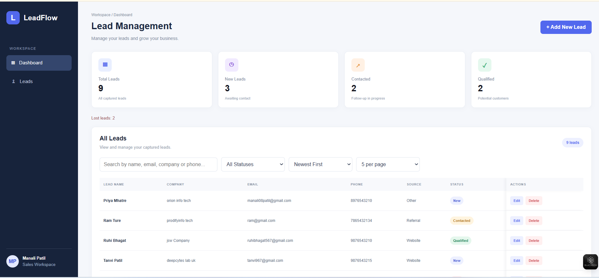
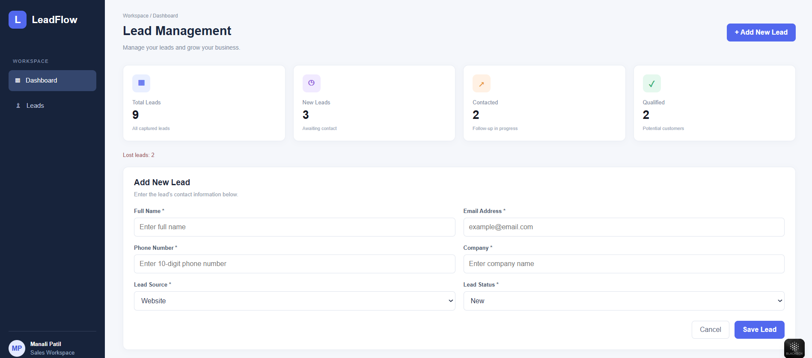
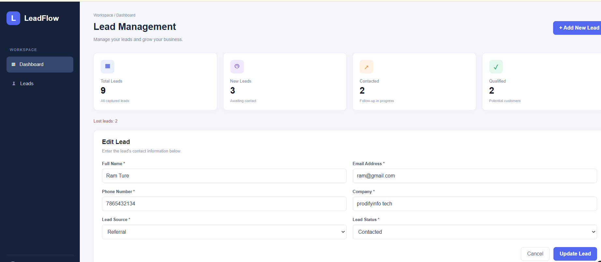

# Lead Manager – LeadFlow

A full-stack Lead Management application designed to help sales teams capture, organize, track, and manage potential customers.

## Project Overview

LeadFlow is a web-based Lead Management System that allows users to maintain customer information and track leads throughout the sales process.

The application provides a dashboard with lead statistics, lead creation and management features, search, filtering, sorting, and pagination.

## Features

- **Dashboard:** View total leads and counts by status.
- **Add Leads:** Create new leads with contact and company details.
- **View Leads:** Display all captured leads in an organized interface.
- **Edit Leads:** Update lead information and status.
- **Delete Leads:** Remove leads with a confirmation prompt.
- **Search:** Search leads by name, email, company, or phone number.
- **Filter:** Filter leads by status.
- **Sorting:** Sort leads by newest, oldest, name A–Z, and name Z–A.
- **Pagination:** Navigate between pages and select the number of leads displayed per page.
- **Form Validation:** Validate required fields, email addresses, and 10-digit phone numbers on the frontend and backend.
- **Responsive UI:** Adapt the interface for desktop and smaller screens.

## Technology Stack

| Technology | Purpose |
|---|---|
| React.js | Frontend user interface |
| Vite | Frontend development server and build tool |
| Node.js | JavaScript runtime |
| Express.js | Backend REST API |
| SQLite | Database |
| HTML5 | Application structure |
| CSS3 | Styling and responsive design |
| JavaScript | Application functionality |
| Git and GitHub | Version control and source code hosting |

## Screenshots

### Dashboard


### Add New Lead


### Edit Lead


## 📂 Project Structure

```text
lead-manager/
│
├── backend/
│   ├── config/
│   ├── controllers/
│   │   └── leadController.js
│   ├── database/
│   │   ├── db.js
│   │   └── init.js
│   ├── middleware/
│   ├── routes/
│   │   └── leads.js
│   ├── server.js
│   ├── package.json
│   └── package-lock.json
│
├── frontend/
│   ├── src/
│   │   ├── App.jsx
│   │   ├── App.css
│   │   ├── index.css
│   │   └── main.jsx
│   ├── index.html
│   ├── package.json
│   └── package-lock.json
│
├── screenshots/
│   ├── dashboard.png
│   ├── add-lead.png
│   └── edit-lead.png
│
├── .gitignore
└── README.md
```

## Installation and Setup

### Prerequisites

Make sure the following are installed:

- Node.js
- npm
- Git

### 1. Clone the Repository

```bash
git clone https://github.com/manali08552/lead-manager.git
```

### 2. Open the Project Folder

```bash
cd lead-manager
```

### 3. Setup the Backend

Open a terminal and run:

```bash
cd backend
npm install
```

Start the backend server:

```bash
npm run dev
```

The backend API will run at:

`http://localhost:5000`

### 4. Setup the Frontend

Open a second terminal from the project root and run:

```bash
cd frontend
npm install
```

Start the frontend:

```bash
npm run dev
```

The frontend will run at:

`http://localhost:5173`

### 5. Open the Application

Open your browser and visit:

`http://localhost:5173`

Keep both backend and frontend servers running while using the application.

## REST API Endpoints

Base URL: `http://localhost:5000/api/leads`

| Method | Endpoint | Description |
|---|---|---|
| GET | `/api/leads` | Retrieve all leads |
| GET | `/api/leads/:id` | Retrieve a lead by ID |
| POST | `/api/leads` | Create a new lead |
| PUT | `/api/leads/:id` | Update an existing lead |
| DELETE | `/api/leads/:id` | Delete a lead |

### Lead Data Fields

Each lead contains:

- Name
- Email
- Phone
- Company
- Source
- Status

### Lead Status Options

- New
- Contacted
- Qualified
- Lost

### Lead Source Options

- Website
- LinkedIn
- Referral
- Advertisement
- Other

## Database

The application uses SQLite for storing lead information.

The leads table includes:

- `id` – Unique lead identifier
- `name` – Lead's full name
- `email` – Email address
- `phone` – Phone number
- `company` – Company name
- `source` – Lead acquisition source
- `status` – Current lead status
- `created_at` – Record creation timestamp

The database is initialized automatically by the backend database module.

## Validation

The application includes frontend and backend validation:

- Required fields cannot be empty.
- Email addresses must follow a valid email format.
- Phone numbers must contain exactly 10 digits.
- Lead status must be one of the supported options.
- Database queries use parameterized SQL statements.

## Future Improvements

- User authentication and authorization.
- Separate lead management for multiple users.
- Advanced filtering and reporting.
- Automated API testing.
- Cloud deployment.
- Export leads to CSV or Excel.

## Project Objective

The objective of this project is to build a practical full-stack application that demonstrates frontend development, REST API development, database integration, CRUD operations, input validation, and responsive user interface design.

## Developed By

**Manali Patil**

GitHub: [manali08552](https://github.com/manali08552)

Project Repository: [Lead Manager – GitHub](https://github.com/manali08552/lead-manager)
